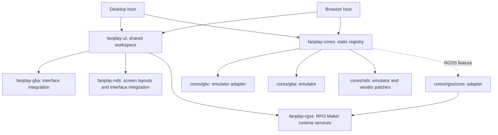

# Fanplay

Fanplay is an experimental player and game library for fangames. It runs RPG
Maker RGSS games and Game Boy / Game Boy Color / Game Boy Advance / Nintendo DS cartridges through a
shared desktop workspace, with a separate browser frontend. Games and
commercial ROMs are not included. Compatibility varies by game.

## What is implemented

| Area | Current implementation |
| --- | --- |
| RPG Maker | Rust RGSS runtime, Ruby compatibility scripts, and native MRI bindings for RGSS 1–3; incomplete compatibility |
| GB / GBC | `mvdnes/rboy` Rust core, DMG/CGB mode detection, input, audio, cartridge saves and save states |
| GBA | RustBoyAdvance-NG adapter, embedded open-source BIOS, input, audio, battery saves and save states |
| DS | Dust adapter, dual screens, touch, audio, cartridge saves and save states; wgpu renderer by default with software fallback |
| Desktop | Game library, repositories, isolated game processes, shared egui workspace, settings, backups and local control API |
| Browser | Shared Rust workspace, ruby.wasm for RGSS, cooperative cartridge execution, folder/ZIP/torrent/ROM imports |
| Plugins | Rhai plugins with declarative metadata, game operations, optional Ruby injection and HTML tools |
| Mobile | Android-specific dependencies exist in the shared UI crate; this checkout has no complete Android or iOS app |

Browser cartridge saves are currently session-local. RGSS browser saves are
mirrored to local storage and can be exported. See the [browser guide](platforms/web/README.md).

## Build and run

Use the [Nix development shell](nix/shell.nix) for native build dependencies:

```sh
nix develop path:.
cargo build --release -p fanplay-desktop
cargo run --release -p fanplay-desktop --bin fanplay
cargo run --release -p fanplay-desktop -- run --game /path/to/game/Game.ini
cargo run --release -p fanplay-desktop -- run --game /path/to/game.gb
cargo run --release -p fanplay-desktop -- run --game /path/to/game.gbc
cargo run --release -p fanplay-desktop -- run --game /path/to/game.gba
cargo run --release -p fanplay-desktop -- run --game /path/to/game.nds
```

The desktop defaults are `gpu`, `gbc`, `gba`, `nds`, and `rgss`. Rust packages declare
1.95 or newer where specified, but Dust also uses unstable APIs: use the
project's Nix toolchain or a compatible nightly. Native desktop builds need
MRI Ruby, libclang, audio/window libraries and, on Linux, GTK/WebKit for plugin
webviews. The Nix shell uses Ruby 4.0; CI's direct Windows/macOS jobs use Ruby 3.4.
A declared target is not a guarantee that every game works on that platform.

With the default features, no arguments opens the library. Interactive `run`
opens the dashboard and starts an isolated game process. Headless execution:

```sh
cargo run --release -p fanplay-desktop -- run \
  --script crates/fanplay-rgss/testdata/rgss_demo.rb --rgss 3 \
  --headless --frames 60 --output /tmp/fanplay.ppm
cargo run -p fanplay-core-runner -- --content /path/to/game.gba \
  --frames 120 --output /tmp/gba.ppm
```

The headless core runner enables GB/GBC, GBA and DS by default; RGSS is opt-in and needs
MRI. Desktop `--renderer auto|wgpu|software` selects RGSS composition, not the
DS renderer. Desktop NDS rendering uses the optimized software path by default;
set `FANPLAY_NDS_RENDERER=wgpu` to opt into the experimental wgpu path. See
[development and validation](docs/development.md).

Gameplay starts with the workspace hidden. F1 reveals it; F2 toggles tools,
F3 output, F4 fullscreen, F10 performance and F11 uncapped execution. Runtime
settings and controller mapping are available in the workspace. CLI options
are defined by `fanplay --help`; `run` does not accept `--fps` or `--uncapped`.

## Ownership



**Emulators stay in `cores/gbc`, `cores/gba` and `cores/nds`.** `fanplay-gba` and `fanplay-nds`
own only Fanplay interface, GUI and connectivity integration. They do not
link the emulator backends. The shared UI still depends on RGSS services;
it is not yet a completely engine-independent application shell.

## Documentation

- [Documentation map](docs/README.md)
- [Architecture and source ownership](docs/architecture.md)
- [Core contract and execution](docs/multi-core-architecture.md)
- [Desktop workspace](docs/dashboard.md)
- [RGSS behavior and limits](docs/rust-port.md)
- [Browser build and limitations](platforms/web/README.md)
- [Storage, repositories and installation](docs/software-provision.md)
- [Control API](docs/control-api.md) and [plugins](extensions/README.md)
- [Rename and data compatibility](docs/rename.md)

The project sources generally use GPL-2.0-or-later. DS-enabled builds also
include GPL-3.0-or-later Dust components; consult [COPYING](COPYING), package
manifests, and the [GBA](cores/gba/THIRD_PARTY_LICENSES.md) and
[DS](cores/nds/THIRD_PARTY.md) notices before redistributing binaries.
