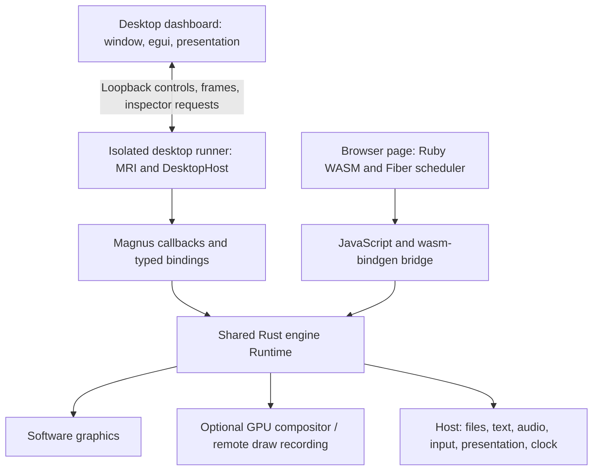
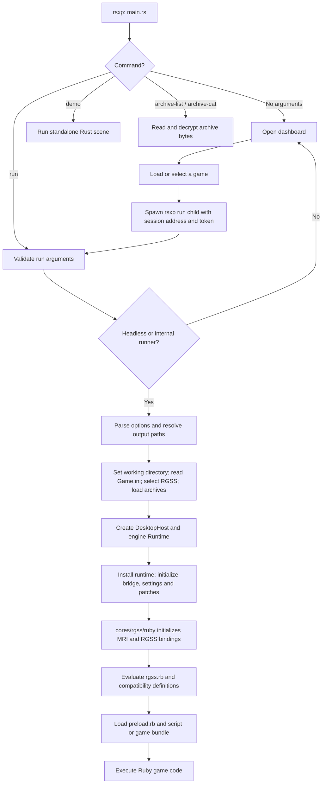
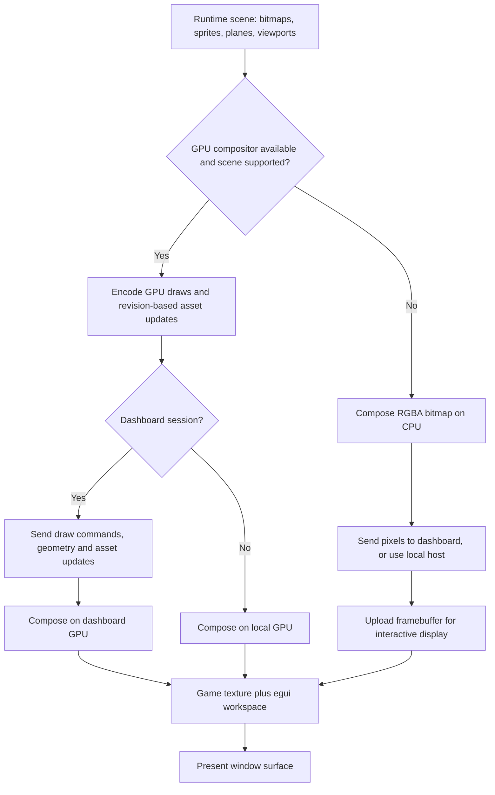
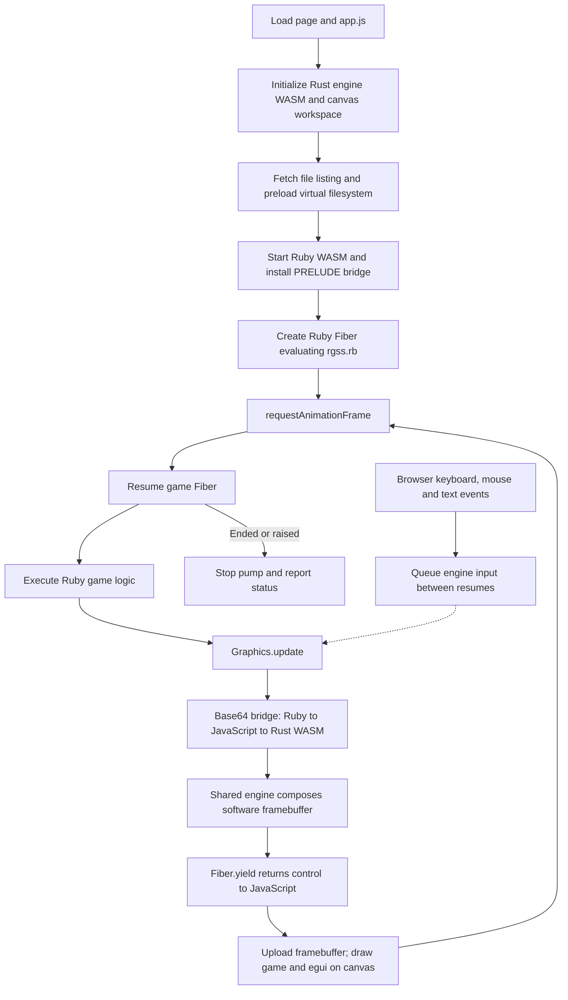

# Architecture

This guide describes the current source tree. RSXP is moving to a multi-core
architecture: `crates/rsxp-core` defines the emulator contract, `cores/` holds
core implementations, and `frontends/` holds applications. The desktop RGSS
path still runs its engine directly while the isolated runner is migrated to
the adapter in `cores/rgss/core`. Ruby executes game logic; Rust stores and
renders the RGSS scene. The dashboard is not the Ruby runtime.

## Execution boundaries



`frontends/desktop/src/main.rs` selects the path:

| Invocation | Execution |
| --- | --- |
| No arguments, default features | Open dashboard with no active game |
| Interactive `run` | Validate arguments, open dashboard, launch runner |
| `run --headless` | Execute runtime directly in the CLI process |
| `run` with internal `RSXP_SESSION_ADDR` | Connect as a dashboard runner, without another dashboard |
| `demo` | Standalone Rust scene; no Ruby game runtime |
| `archive-list` / `archive-cat` | Decode archive data; no Ruby execution |

The dashboard owns winit, egui and its presentation GPU on the main thread.
`dashboard::Session` starts the same executable with `run`, a loopback address
and a per-launch random token. Background threads collect output and exchange
frames and controls. Dropping a session kills and waits for the child. This is
one active game per dashboard, not multiple Ruby VMs inside one process.

The runner owns its working directory, MRI globals, engine state, decoding and
audio. A control reader feeds a bounded queue; only the initial control handshake
waits for a reply. Later updates drain available controls. Socket writes and
bounded queues can still impose backpressure. The dashboard keeps the latest
view and merges ordered GPU asset updates rather than discarding required data.
See [workspace](dashboard.md) and [transport measurements](session-performance.md).

## Workspace layout and Cargo features

The repository is a virtual Cargo workspace. The dependency direction is
frontend → `rsxp-core` ← core; a core never depends on a frontend or on the
RGSS application.

| Path | Purpose |
| --- | --- |
| `crates/rsxp-core/` | Emulator-core contract: video/audio/input/control/events, no RGSS or frontend dependencies |
| `crates/rsxp-frontend/` | Generic core catalog, content routing and dedicated core-thread driver |
| `crates/rsxp-rgss/` | The `rsxp` engine package: graphics, GPU compositor, archives, media, Ruby shim and current RGSS workspace UI |
| `cores/rgss/core/` | RGSS adapter implementing `rsxp_core::Core` |
| `cores/rgss/ruby/` | MRI embedding and all Magnus bindings (package `rsxp-rgss-ruby`) |
| `frontends/desktop/` | Desktop binary, dashboard, window, audio, presentation and session transport |
| `web/` | Browser frontend (separate Cargo workspace) |
| `mobile/` | iOS/Android host (separate Cargo workspace) |

The engine package still uses the library name `rsxp`, so existing engine and
frontend imports remain valid. The MCP binary is built by the engine package
from `crates/rsxp-rgss/api/main.rs`. The browser crate has its own manifest in
`web/engine/`.

See [multi-core architecture](multi-core-architecture.md) for the core contract,
hot-path rules and migration phases.

| Feature | What it enables |
| --- | --- |
| No default features | Engine, CPU graphics, archives, Tables, patch catalog and runtime settings |
| `ui` | Shared egui panels and workspace service adapter |
| `gpu` | Shared wgpu compositor, GPU presentation dependencies and `ui` |
| `game-api` | JSON/image dependencies and game API bridge; native cable services outside wasm |
| `api-docs` | Utoipa declarations used by `rsxp-mcp` |

The engine library defaults to `gpu`; the desktop package enables its `gpu`
frontend and the needed engine features. The MCP binary requires `api-docs`.
The browser depends on the engine library with `ui` and `game-api`, and
separately uses wgpu for canvas presentation. Browser game composition is
software: using wgpu for the workspace does not enable the shared GPU compositor.
Magnus is a private dependency of `rsxp-rgss-ruby`; the engine library and
desktop application use the crate's Rust-only interface.

## Startup and shutdown

The startup graph follows the default desktop build. Interactive launches first
create the dashboard; headless launches enter the runtime directly. Both reach
the same game initialization code.



The child sees the internal session address and takes the runtime branch,
avoiding recursive dashboard creation. Its host connects back to the dashboard;
a headless host instead uses silent audio and no window.

`frontends/desktop/src/runtime/options.rs` validates arguments and resolves capture paths
before changing directories. `runtime/game.rs` sets the working
directory, reads Game.ini, infers the RGSS version and loads recognized archives.
Startup environment changes precede the host's thread-creating subsystems.

`runtime::run` creates `DesktopHost` and `engine::Runtime`, installs the active
runtime, initializes API/bridge state, resets live settings and applies startup
patch selections. It initializes MRI once, attempts to enable YJIT, registers
Magnus bindings and evaluates the compile-time Ruby bundle from `crates/rsxp-rgss/src/ruby/`. That shim supplies
RGSS classes, compatibility behavior and game script loading.

On completion Ruby is dropped while the native registries still exist, so
finalizers can release resources. The runner then
takes the runtime, optionally captures the last frame, and returns the Ruby
status. Reset recreates the process rather than reinitializing MRI in place
(the runtime uses `exec` on Unix). The dashboard remains available after a game
stops or is replaced.

## Ruby bridge and resource ownership

`rgss.rb` holds Ruby-facing RGSS properties. It compares snapshots to avoid
sending unchanged sprite, plane and viewport state; mutable Rect, Color and
Tone values must be compared by value. Serialized operations enter
`engine/commands.rs`. Desktop sprites also have a typed Magnus snapshot path
in `bindings/sprite.rs`, which calls the same runtime registries directly.
The browser serializes through a base64 JavaScript bridge into wasm exports.
Desktop Tables are GC-owned Magnus objects; browser Tables use the portable fallback in the same RGSS source bundle.

The active runtime is a thread-local `RefCell<Option<Runtime>>`. It owns
bitmaps, sprites, planes and viewports under numeric IDs and holds no Ruby heap
values. Wrappers release resources on disposal/finalization. Convert Ruby
arguments before borrowing the runtime: GC can run finalizers that reenter the
bridge, and nested mutable runtime borrows are invalid.

Bitmap pixels use copy-on-write sharing. Mutations advance revisions used by
GPU upload caches. Retained scene order has separate invalidation for changes
to membership and ordering. These caches avoid work without making the Ruby
object graph the renderer's source of truth.

## One game frame

This sequence shows an interactive dashboard session. The game runs until Ruby
calls Graphics.update; changes to Ruby objects alone do not present a frame.
The transport can deliver frames independently of the dashboard's redraw loop.

```mermaid
sequenceDiagram
    participant Ruby as Game Ruby / rgss.rb
    participant Bridge as Magnus bridge
    participant Engine as engine::Runtime
    participant Host as Runner DesktopHost
    participant UI as Dashboard
    Ruby->>Ruby: Change sprites, planes and viewports
    Ruby->>Bridge: Graphics.update: synchronize changed snapshots
    Bridge->>Engine: Serialized commands or typed sprite state
    Ruby->>Bridge: graphics_update
    Bridge->>Engine: update_frame
    Engine->>Engine: Check limit; apply settings and queued input
    Engine->>Host: Poll controls and input
    Host-->>Engine: Available controls, or stop
    Engine->>Engine: Inject scripted input; compose scene
    Engine->>Host: Present GPU submission or software bitmap
    Host->>UI: Transport frame and metrics
    Note over UI: Redraw independently using newest received view
    Engine->>Engine: Advance counters and apply pacing
    Engine-->>Bridge: Complete update
    Bridge-->>Ruby: Return to game code
```


1. Ruby changes RGSS objects. `Graphics.update` synchronizes their state.
2. `graphics_update` dispatches into `engine/frame.rs::update_frame`.
3. The runtime checks the independent update limit, applies live pacing
   settings, begins pending input, applies queued events, polls the host and
   injects scripted input. F10 toggles the FPS display and F11 toggles uncapped
   execution.
4. The runtime attempts GPU rendering when available. Unsupported GPU scene
   cases return to software composition.
5. Scene draws respect ordering and viewport grouping. Viewport effects apply
   to the combined children. Frame effects include freeze/transition and brightness.
6. The host presents or transports the result. The runtime reports timings,
   advances counters and paces non-headless execution. Pacing budgets include
   Ruby work between updates; headless execution does not sleep.

Input state tracking and Ruby `Input.update` remain distinct from polling host
events. In the browser, the patched Graphics update yields the Ruby Fiber;
JavaScript presents the workspace and resumes Ruby on a later animation frame.
Code that does not yield can still block the page.

## Rendering and platform services

`graphics/` implements CPU bitmap operations, rasterization and effects.
`engine/render_software.rs` turns runtime resources into software draws.
`engine/render_gpu.rs` translates the scene to the optional compositor. Visible
planes whose scaled tile dimensions are fractional/non-finite, and patterned
sprites with zero pattern zoom, trigger software fallback to preserve behavior.

`gpu/` manages devices, revision-based uploads, draw encoding, batching,
submission and readback. Native tile geometry and atlas caches live in
`graphics/tilemap.rs`. Adjacent disjoint operations can share dispatches;
unchanged compositions can be reused.

In dashboard sessions, the GPU path records and transports draw commands,
geometry and asset updates for composition on the dashboard device. This is
not cross-process sharing of a GPU texture. Software sessions send pixels for
upload. Captures and snapshot/freeze operations materialize pixels when needed;
ordinary remote GPU frames avoid framebuffer readback.

The rendering decision is separate from presentation. In particular, a software
composed frame still needs the dashboard GPU to appear in its window.



This graph describes interactive presentation. Headless runs still compose but
skip window presentation. Explicit captures and snapshots can materialize CPU
pixels from the GPU path.

`engine/host.rs::Host` supplies file reads, image decoding, text measurement and
rasterization, input, presentation, window controls, audio, clocks and sleeping.
Desktop implementations use the filesystem, image/fontdue and Kira/CPAL.
Browser implementations use virtual files, image/fontdue and browser media/Web
Audio. Archive resolution lives in the engine asset layer, above host file reads.

## Browser startup and scheduling

The browser shares the engine and panel code, but does not launch a child
process or embed Ruby through Magnus. The page initializes the engine WASM,
preloads assets, starts Ruby WASM, installs the bridge/adaptations and creates a
Fiber that evaluates rgss.rb. The full file listing falls back to the warm
manifest when unavailable.



Startup also yields between batches of Ruby preparation work. The Fiber is
cooperative: a long Ruby operation without a yield blocks page interaction.
The wgpu canvas presenter does not change software game composition into GPU
composition. See [browser setup and limitations](../web/README.md).

## Workspace and inspection

Shared panels live in `crates/rsxp-rgss/src/ui/`, with a `ui::backend::Backend` service contract.
`workspace_services::LocalServices` adapts local settings, patches, API requests,
assets and native cable services. The dashboard also routes remote session
controls and replies. Session/library/save actions are frontend intents; the
shared panel code does not own a Ruby VM.

`crates/rsxp-rgss/src/api_bridge.rs` queues requests for Ruby to service on the game thread.
`crates/rsxp-rgss/api/game_bridge/` reads game state and applies input/transfer operations.
HTTP and `rsxp-mcp` are external interfaces to this mechanism; inspector panels
do not require an HTTP listener. Pokémon Essentials introspection is
version/game dependent. Native `cable_club.rs` and `cable_unmod.rs` provide
separate relay services, not a general HTTP implementation for game scripts.

## Source map

| Area | Source |
| --- | --- |
| Emulator-core contract | `crates/rsxp-core/` |
| Core catalog, routing and core thread | `crates/rsxp-frontend/` |
| RGSS core adapter | `cores/rgss/core/` |
| Public engine modules and compatibility re-exports | `crates/rsxp-rgss/src/lib.rs` |
| Runtime registries and bridge entry points | `crates/rsxp-rgss/src/engine/mod.rs` |
| Protocol, assets, input, frame and scene order | `crates/rsxp-rgss/src/engine/{commands,assets,input,frame,scene}.rs` |
| Composition | `crates/rsxp-rgss/src/engine/render_software.rs`, `render_gpu.rs` |
| CPU types, pixels and effects | `crates/rsxp-rgss/src/graphics/` |
| GPU setup, resources, commands, batching, submission and transport | `crates/rsxp-rgss/src/gpu/` |
| Archive decryption and Table storage | `crates/rsxp-rgss/src/data/` |
| Ruby compatibility classes and game loader | `crates/rsxp-rgss/src/ruby/`; `rpg1.rb`, `rpg2.rb`, and `rpg3.rb` are taken from mkxp-z |
| Desktop entry and runtime lifecycle | `frontends/desktop/src/main.rs`, `frontends/desktop/src/runtime/` |
| Dashboard, transport, library and save backups | `frontends/desktop/src/{dashboard,session,library,saves}.rs` |
| Platform services | `frontends/desktop/src/{host,window,gpu_present,media,audio}.rs` |
| Ruby VM, Magnus and Win32 adapters | `cores/rgss/ruby/src/` |
| Workspace panels and services | `crates/rsxp-rgss/src/ui/`, `crates/rsxp-rgss/src/workspace_services/`, `crates/rsxp-rgss/src/workspace_services.rs` |
| Runtime patch catalog and Ruby patch bodies | `crates/rsxp-rgss/src/patches/` |
| Browser scheduling and Ruby adaptations | `web/browser/app.js` |
| Browser exports, services and presentation | `web/engine/src/` |
| HTTP/MCP and game-thread adapter | `crates/rsxp-rgss/api/`, `crates/rsxp-rgss/src/api_bridge.rs` |
| Tests and benchmark workloads | `crates/rsxp-rgss/src/engine/tests.rs`, `crates/rsxp-rgss/src/graphics/tests.rs`, `crates/rsxp-rgss/src/gpu/tests.rs`, `frontends/desktop/tests/cli.rs`, `crates/rsxp-rgss/testdata/`, `crates/rsxp-rgss/examples/` |

Paths are relative to the repository root. Start a new RGSS operation in the
Ruby shim and command dispatcher, keeping typed desktop paths consistent.
Platform changes belong behind Host; pixel changes need CPU/GPU parity checks.
See the [README](../README.md#development-checks) for validation commands and
[browser guide](../web/README.md) for the actual wasm build.

## Shared workspace services

Both frontends enable `ui` and `game-api`: the browser no longer excludes the
inspector, map previews or Pokémon tools. `crates/rsxp-rgss/src/api_bridge.rs` is the shared
nonblocking game-thread queue and operation routing; only
`crates/rsxp-rgss/src/api_bridge/transport.rs` owns the desktop HTTP listener.
`crates/rsxp-rgss/api/game_bridge/` is compiled into the same game operations for both interpreters.
The browser does not need network access to inspect the running game.

`LocalServices` accepts an asset reader for hosts without native files/workers.
The browser injects its virtual file reader and caches decoded preview images;
desktop keeps its background filesystem decoder. The shared UI uses a portable
clock. Browser VM compatibility setup lives once in `web/browser/ruby-host.js`,
imported by the page and the headless integration runner. `Table` fallback
storage lives in the shared RGSS shim, selected only without native bindings.

Interpreter embedding, native retained-state acceleration, composition backend,
save persistence, process launching and network transport still have host-specific
implementations. They are not additional game-logic or tool-panel implementations.
