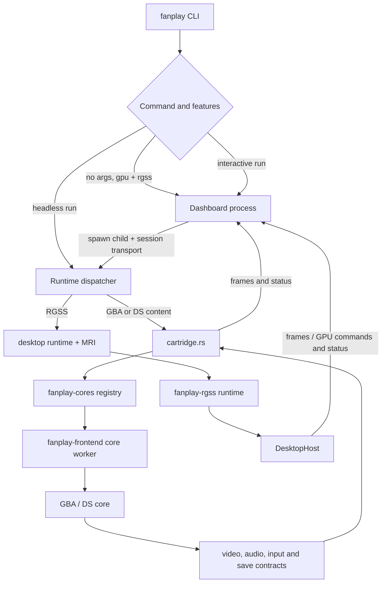
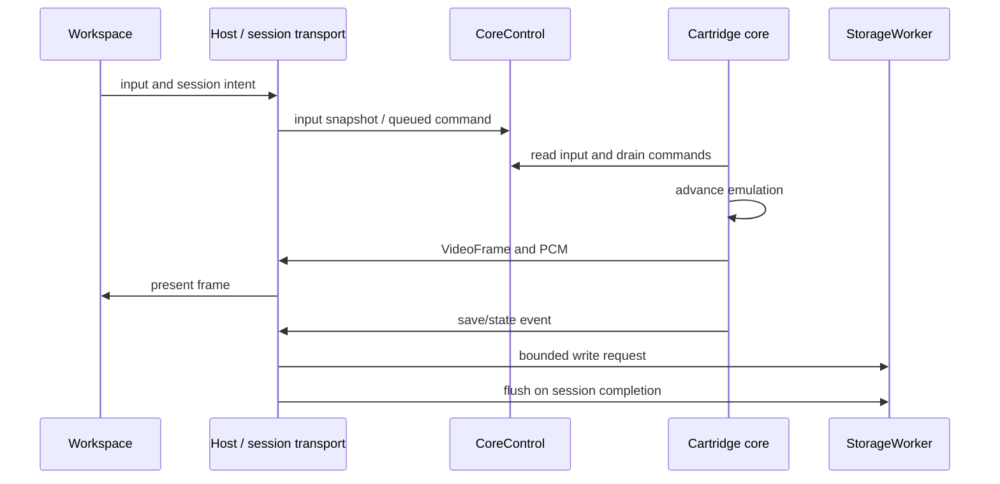
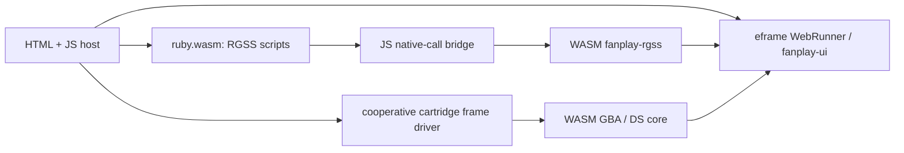

# Architecture

Fanplay has separate emulator execution, platform hosts, interface integration,
and shared services. This is the implemented layout, not a target architecture.

## Workspace map

| Path / package | Responsibility |
| --- | --- |
| `crates/fanplay-core` | Core trait, content, input, audio/video contracts, commands, events and state envelopes |
| `crates/fanplay-frontend` | Content routing, native core workers, pixel conversion, content identity and save storage |
| `crates/fanplay-cores` | Compile-time core registry; default features `gba` and `nds`, optional `rgss` |
| `cores/gba/core` / `fanplay-core-gba` | RustBoyAdvance-NG adapter and BIOS assets |
| `cores/nds/core` / `fanplay-core-nds` | Dust adapter; local dependency patches remain in `cores/nds/vendor` |
| `cores/rgss/core` / `fanplay-core-rgss` | Generic-core adapter for the RGSS runtime |
| `cores/rgss/ruby` / `fanplay-rgss-ruby` | MRI embedding and Magnus bindings; Rust library name `ruby_rgss_core` |
| `crates/fanplay-rgss` | RPG Maker runtime, resources, renderers, media, Ruby shim, patches and game bridge; package `fanplay-rgss`, import `fanplay_rgss` |
| `crates/fanplay-gba` | GBA library/interface presentation, no emulator dependency |
| `crates/fanplay-nds` | DS screen geometry, layout selection, painting and library presentation, no emulator dependency |
| `crates/fanplay-ui` | Shared eframe app, workspace, themes, panels and runtime service adapter |
| `crates/fanplay-provision` | Portable storage, repositories, verified installation, settings and backups |
| `crates/fanplay-control` | Typed control catalog and native loopback HTTP transport |
| `crates/fanplay-api` | Operation discovery/routing without a socket or emulator |
| `crates/fanplay-extension-api` | Serializable plugin contracts |
| `crates/fanplay-extensions` | Rhai loading, metadata, capabilities and operation orchestration |
| `crates/fanplay-extension-ui` | Plugin UI declarations and host adaptation |
| `frontends/desktop` | `fanplay` executable, device services, dashboard, child processes and webviews |
| `frontends/core-runner` | Headless generic-core driver |
| `platforms/web` | Separate Cargo workspace: native web host, WASM engine and build task |

## Native execution

The desktop RGSS route uses `frontends/desktop/src/runtime` directly. It does
not simply launch every game through the generic RGSS core adapter. The latter
exists for clients of the core contract, including the headless runner.
Both routes currently contain RGSS game-preparation code. They must remain
consistent when startup behavior changes.

The dashboard supervises one game session at a time. `session.rs` carries
framed messages between dashboard and runner. A cartridge runner owns a generic
core worker plus host-side frame/audio/save handling. RGSS owns MRI and the
game working directory in its process. Exit/reset/close are host lifecycle
operations, not evidence that Ruby can safely run concurrently in arbitrary
in-process threads.

## Frame and control flow

Core frames are borrowed buffers with explicit dimensions, stride and pixel
format. `fanplay-frontend/src/video.rs` converts supported formats. The native
cartridge host uses a bounded frame queue and PCM ring; save writes use a
bounded worker. GBA's upstream battery-save path also uses the native save
directory directly, so not every backend write goes through the worker.

RGSS has its own Ruby-to-Rust command bridge and retained rendering path.
`fanplay-rgss/src/engine` owns resources, scene/frame execution and commands;
`graphics` supplies CPU composition, and `gpu` supplies wgpu composition and
remote submissions. Composition and host presentation are separate choices.

## Browser execution

The browser owns scheduling and virtual files. It cannot block the main thread
in a native-style infinite core loop. Cartridge core calls cooperate with the
browser frame driver. RGSS runs in a separate Ruby WASM module and uses the JS
bridge to reach the Rust engine. RGSS composition is software; eframe uses
wgpu for presentation. No native MRI process or desktop loopback listener is
embedded in a browser tab.

## Current dependency limits

- `fanplay-ui` still uses RGSS `Bitmap`, controls and runtime services. Moving
  the workspace source out of RGSS did not remove those dependency edges.
- GBA/DS interface crates are separate from their emulator crates. Screen
  layout changes belong in `fanplay-nds`; emulation, BIOS and backend save
  behavior belong in `cores/nds`.
- The native dashboard is gated on both `gpu` and `rgss`. A cartridge-only
  desktop build can run headlessly without MRI; it is not a standalone generic
  graphical dashboard.
- Android-specific eframe settings exist, but there is no complete mobile
  application or build tree in this checkout.
- Plugins extend operations and UI, not the static emulator registry. There
  is no implemented dynamic emulator plugin ABI.

For build defaults and checks, see [development](development.md). For storage
identity and core capabilities, see [the core contract](multi-core-architecture.md).
