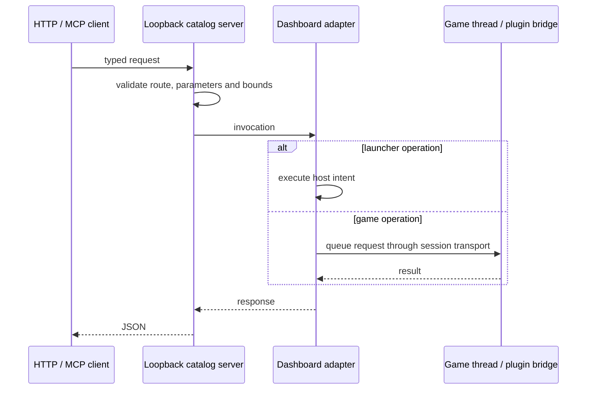

# Control API

The canonical native catalog is
[`fanplay-control/src/catalog.rs`](../crates/fanplay-control/src/catalog.rs).
It declares endpoint IDs, HTTP routes, parameter types, schemas and discovery.
The native HTTP implementation is `server.rs`; desktop operations are adapted
by `frontends/desktop/src/control.rs`. RGSS game operations go through the
runtime request queue rather than execute Ruby on a network thread.

## Native endpoint

The default endpoint is `http://127.0.0.1:47821`. Launcher settings store API
enablement and port in the portable home's `config/config.json`.
`FANPLAY_API=0` disables it; `FANPLAY_API=1` requests it, and
`FANPLAY_API_PORT` selects the port. The launcher owns its listener across game
sessions. RGSS headless startup can enable a game-side listener; launcher-only
operations are unavailable there. Do not assume every headless cartridge host
exposes the RGSS game-side listener.

The server is loopback-only, uses bounded requests/timeouts, and has no TLS,
HTTP/2 or general-purpose web-server behavior. Cross-origin access is opt-in
with `FANPLAY_API_CORS=1`. Local clients do not need browser CORS headers.

```sh
curl -s http://127.0.0.1:47821/v1/discovery
curl -s http://127.0.0.1:47821/v1/status
curl -s http://127.0.0.1:47821/v1/openapi.json
```

Use live discovery for available launcher, settings, catalog, save and game
operations. Loaded extensions can add routes and operation declarations, so a
static endpoint list is not the full live contract. Availability depends on
host and active session. An advertised declaration is not a successful game
operation until its request has executed.



## Browser and plugins

The browser cannot listen on a native TCP port. It exposes
`window.FANPLAY.control.discovery()` and
`window.FANPLAY.control.request(method, path, body)` through its host adapter.
Only browser-available operations can execute. RGSS browser saves/settings
use local storage; cartridge persistence is currently session-local.

`fanplay-api` handles operation registry/routing without owning sockets.
`fanplay-extensions` loads Rhai declarations and orchestrates requests.
Game-specific semantics remain in plugins and runtime adapters. See
[plugins](../extensions/README.md).

## MCP and schema generation

`fanplay-mcp` is a stdio MCP client bridge to the running local API; it does not
start a game runtime. Its tools are built from discovery and extension routes.

```sh
cargo build --release -p fanplay-rgss --no-default-features \
  --features api-docs --bin fanplay-mcp
cargo api-openapi > crates/fanplay-rgss/api/openapi.json
```

The checked-in OpenAPI file is generated from the standard Rust catalog.
Runtime discovery can include additional extension routes and live status.
See [MCP setup](../crates/fanplay-rgss/api/README.md).
