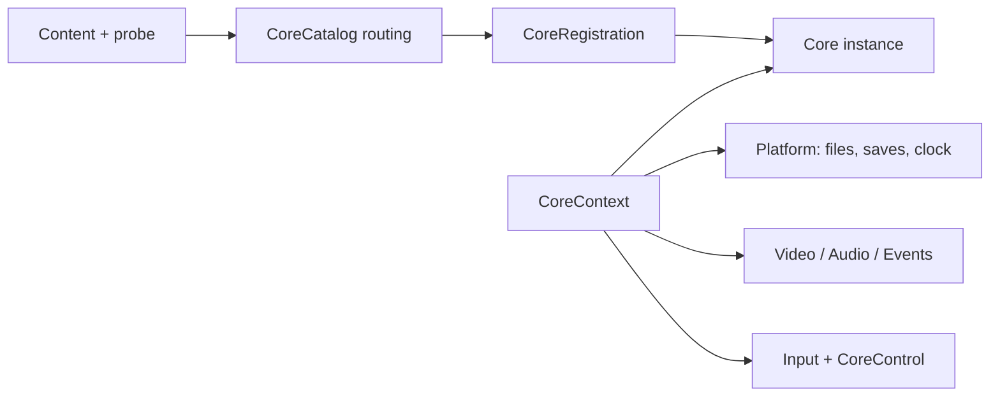

# Core contract and execution

The source of the contract is [`fanplay-core`](../crates/fanplay-core/src/lib.rs).
The implementation is statically linked: `fanplay-cores::catalog()` registers
cores selected by Cargo features. It enables GBA and DS by default; RGSS is
optional. Core IDs remain `gba`, `nds`, and `rgss` across the project rename.

## Boundary

A core receives content and a `CoreContext`, then executes through the `Core`
trait. The context supplies platform file/save services, video/audio/event
sinks, shared input/control and session preferences. Core metadata declares
capabilities, formats, buttons, screen geometry, audio and options. The
frontend must use that metadata rather than assume every core supports every
command. Capability bits are not promises that all bits are implemented.

`fanplay-frontend::spawn_core` supplies a native worker and completion handling.
The browser uses cooperative execution instead; it does not spawn that native
thread. RGSS embeds MRI and changes the working directory, so hosts must
respect its process-level ownership requirements.

## Implementations

| Core | Source | Backend / behavior |
| --- | --- | --- |
| GBA | `cores/gba/core` | RustBoyAdvance-NG; 240×160 output, embedded BIOS replacement, stereo PCM, battery/state support |
| DS | `cores/nds/core` | Dust; stacked 256×384 output, touch on lower screen, software rendering by default, optional native wgpu |
| RGSS | `cores/rgss/core` | `fanplay-rgss` plus MRI bindings; generic adapter in addition to the desktop's direct RGSS runtime |

There is no GB/GBC core in this checkout. Future systems need a real adapter,
registration, host support and conformance tests before being documented as
supported. UI integration goes into `crates/fanplay-<system>` without moving
emulator code out of `cores/<system>`.

## Saves and identity

`fanplay-frontend/src/storage.rs` defines `ContentId`, `SaveStore`, native and
in-memory storage, and a bounded `StorageWorker`. Native cartridge data is
scoped by core ID and content identity, so equal titles need not share saves.
The default desktop location is the provision home, followed by
`saves/<core>/<content-id>/save` and `states`. The standalone runner has its
own data-directory policy and accepts `--save-dir`.

`fanplay-core/src/state.rs` wraps backend state with a version, core ID, state
revision, content hash and integrity check. Corrupt or incompatible envelopes
are rejected before restore. GBA and DS tests exercise deterministic replay
and rejection behavior. These states are backend-version-specific, not an
interchange format with upstream emulator applications.

The old `RSXPSAV` magic and `.rsxpstate` file suffix remain deliberately stable
for existing saves. They are disk-format identifiers, not the current product
name. See [rename compatibility](rename.md).

## Host limits

Desktop storage is persistent. The browser cartridge host currently uses an
in-memory store; GBA's upstream filesystem save path is also unavailable as a
normal writable native directory on WASM. Do not describe browser cartridge
persistence as equivalent to native persistence. RGSS browser save mirroring
is a separate JavaScript facility.

The [core conformance guide](core-conformance.md) identifies the available
tests. Passing generated-ROM tests does not establish compatibility or frame
rate for every commercial game or fangame.
