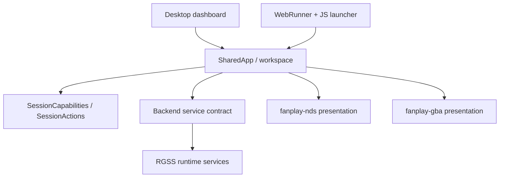

# Shared frontend and platform adapters

`fanplay-ui::SharedApp` and `fanplay-ui::ui` own the eframe workspace, session
widgets, themes, game texture and plugin interaction. Desktop and browser
adapters supply capabilities and execute user intents. File dialogs, native
process creation, browser downloads and device audio belong to those adapters.

Sources:

- `crates/fanplay-ui/src/lib.rs`: shared application and texture presentation.
- `crates/fanplay-ui/src/ui/backend.rs`: runtime-service boundary.
- `crates/fanplay-ui/src/ui/session.rs`: capabilities and session actions.
- `frontends/desktop/src/dashboard.rs`: native lifecycle and intent handling.
- `platforms/web/browser/launcher-controller.js`: browser import/launch state.
- `platforms/web/engine/src/lib.rs`: WASM exports and shared UI integration.

The shared application still depends on `fanplay-rgss` for bitmap, controls and
runtime-service integration. It is not a fully generic shell. The GBA/DS UI
crates have no emulator dependency; core execution stays under `cores/`.

There are Android-specific eframe/winit dependencies and package metadata in
`fanplay-ui/Cargo.toml`. There is no complete Android activity/project or iOS
application in this checkout. Mobile support must not be documented as a
working app based solely on those dependency settings.
