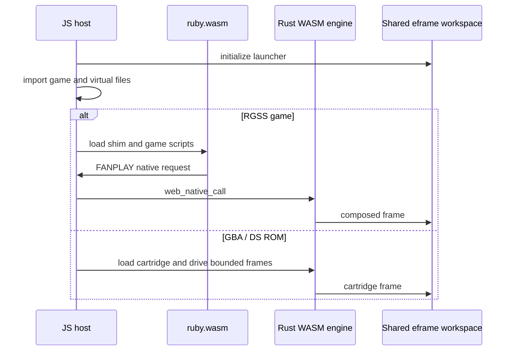

# Fanplay browser frontend

This is a separate Cargo workspace. `fanplay-web-engine` builds the Rust WASM
module (`fanplay_web`); `fanplay-web` is a native executable that serves or
exports the generated player. `xtask` orchestrates the build.

## Build

From the repository root, in the development environment:

```sh
cargo xtask web
platforms/web/target/release/fanplay-web serve
platforms/web/target/release/fanplay-web serve /path/to/game
platforms/web/target/release/fanplay-web export player.html
platforms/web/target/release/fanplay-web embed /path/to/game game.html
npm --prefix platforms/web test
```

The build task provisions the pinned Ruby WASM runtime (or accepts
`--ruby-runtime DIR`), builds `wasm32-unknown-unknown`, runs matching
wasm-bindgen and wasm-opt, inlines the player modules/runtime, and builds the
native host. Node/npm, a WASM-capable Rust toolchain, wasm-ld and wasm-opt are
required. See `xtask/src/main.rs` for exact versions and overrides.
`dist/` and `target/` are generated and ignored. Rebuild them after source or
branding changes; existing exports contain the old program.

## Runtime



RGSS uses a separate Ruby WASM module and a JS bridge to the Rust engine.
Scheduling cooperates with the browser instead of blocking a native thread.
The game compositor is software; eframe/wgpu presents the workspace with
WebGPU/WebGL support enabled. Cartridge execution uses the same core contracts
as native hosts, with browser-specific file and frame scheduling adapters.

`launcher-controller.js` and `game-import.js` handle folder, ZIP, torrent and
ROM input. The shared workspace owns widgets; the browser supplies file
pickers and downloads. Extensions may open HTML tools through the JS host.
Browser actions do not imply native filesystem/process access.

## Persistence and limitations

RGSS save files are mirrored to local storage and can be exported/imported as
JSON. Backups, browser settings and controller mapping also use local storage.
On the same origin, `storage-compat.js` reads old RSXP values when no Fanplay
value exists and attempts a non-destructive copy. A different origin has a
different browser storage area; use export/import when moving hosts.

**Cartridge saves currently stay in memory for the session.** The cartridge
host does not provide durable browser persistence equivalent to native
`SaveStore`. GBA's upstream direct filesystem battery-save path has additional
WASM limitations. Do not rely on a browser cartridge session for durable saves.

The browser exposes `window.FANPLAY.control` for discovery and requests; it
cannot bind the native loopback HTTP listener. Browser plugin/network actions
are constrained by browser APIs and origin policies. Arbitrary native DLLs,
MRI extensions and native JIT are not available.

## Tests

`npm test` includes source-level JS tests and tests importing generated WASM;
it requires a fresh `cargo xtask web` build. `tests/game-e2e.mjs` additionally
needs local game content. `npm run benchmark` measures a defined bridge/render
workload, not universal game FPS. See [development](../../docs/development.md).
